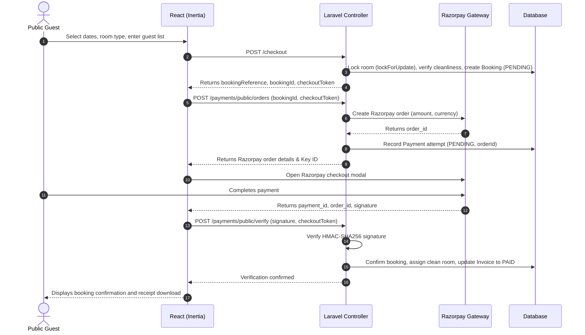
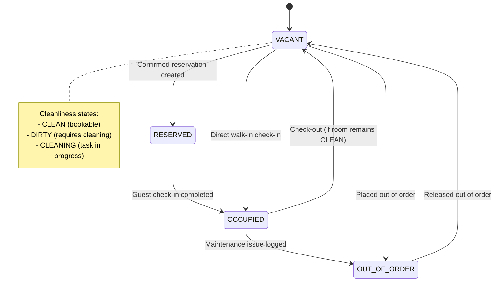

# Nivara Hotels

A full-stack hotel management and online room reservation system built with **Laravel 13**, **Inertia.js v3**, **React 19**, **Laravel Fortify**, and **Tailwind CSS v4**. Nivara Hotels provides a modern public-facing portal for room discovery and online booking, alongside a comprehensive, role-guarded operations dashboard for hotel staff and administrators.

---

## Table of Contents

1. [Project Overview](#project-overview)
2. [Technology Stack](#technology-stack)
3. [Architecture and Repository Structure](#architecture-and-repository-structure)
4. [Implemented Features](#implemented-features)
5. [User Roles and Permissions](#user-roles-and-permissions)
6. [Authentication and Authorization](#authentication-and-authorization)
7. [Core Application Workflows](#core-application-workflows)
8. [Route Catalog](#route-catalog)
9. [Database Schema, Models, and Enums](#database-schema-models-and-enums)
10. [Environment Configuration](#environment-configuration)
11. [Installation and Local Setup](#installation-and-local-setup)
12. [Available Scripts and Commands](#available-scripts-and-commands)
13. [Build and Deployment](#build-and-deployment)
14. [Codebase Verification and Audit Notes](#codebase-verification-and-audit-notes)

---

## Project Overview

Nivara Hotels is structured as a monolithic **Laravel + Inertia.js + React** application located in `src/`:
- **Backend (`src/app`, `src/routes`, `src/database`)**: A Laravel 13 application using Eloquent ORM, Laravel Fortify for authentication, database migrations, model observers for audit logging, and controller-driven JSON/Inertia responses for reservations, payments, housekeeping, maintenance issues, staff management, and reporting.
- **Frontend (`src/resources/js`)**: A TypeScript-powered React 19 + Inertia.js v3 interface bundled with Vite 8 and Tailwind CSS v4, serving both public visitors and authenticated hotel employees across four distinct dashboard experiences without a separate API server or client-side router.

The system emphasizes strict transactional integrity for hotel bookings (pessimistic row-level database locking via `lockForUpdate()` to prevent double-booking), automated status transitions between housekeeping tasks and room readiness, and end-to-end payment lifecycle handling (front-desk cash, UPI/QR, and online Razorpay orders, HMAC-SHA256 signature verification, webhooks, and refunds).

---

## Technology Stack

### Backend (`src/composer.json`)

| Category | Technology | Version | Purpose |
| :--- | :--- | :--- | :--- |
| **Language** | PHP | `^8.3` | Server-side runtime and strict enum/type modeling |
| **Framework** | Laravel Framework | `^13.17` | Routing, Eloquent ORM, validation, storage, mail, queues |
| **SPA Bridge** | Inertia.js Laravel | `^3.7` | Server-driven routing and shared props to React pages |
| **Authentication** | Laravel Fortify | `^1.43` | Session authentication, registration, password reset, rate limiting |
| **Database** | SQLite / PostgreSQL / MySQL | — | Configurable via Laravel `DB_CONNECTION` (SQLite default in `.env.example`) |
| **File Storage** | Laravel Filesystem (`public` disk) | — | Local storage for room images, avatars, ID proofs, signatures, and issue attachments |
| **Payment Gateway** | Razorpay HTTP / Webhook Integration | — | Order creation, HMAC-SHA256 verification, refunds, and webhook reconciliation |
| **Code Quality & Dev** | Laravel Pint, Pail, Boost, Tinker | `^1.27` / `^1.2.5` | Code formatting, log tailing, and interactive REPL |
| **Testing** | PHPUnit, Mockery, Faker | `^12.5.12` | Feature and unit testing |

### Frontend (`src/package.json`)

| Category | Technology | Version | Purpose |
| :--- | :--- | :--- | :--- |
| **Library** | React & React DOM | `^19.3.1` | Component-based UI library |
| **SPA Adapter** | `@inertiajs/react` & `@inertiajs/vite` | `^3.11.0` | Inertia page resolution, forms, navigation, shared auth props |
| **Build Tool** | Vite & `laravel-vite-plugin` | `^8.0.0` / `^3.1` | Fast HMR development server and production asset bundling |
| **Language** | TypeScript | `^7.0.2` | Type safety across pages, features, and API contracts |
| **Styling** | Tailwind CSS & `@tailwindcss/vite` | `^4.0.0` | Utility-first CSS styling and theme tokens |
| **Forms & Validation** | React Hook Form, `@hookform/resolvers`, Zod | `^7.92.0` / `^7.0.8` / `^4.6.7` | Form state management and schema validation |
| **UI Components** | shadcn/ui & Base UI (`@base-ui/react`) | `^4.23.0` / `^1.9.0` | Accessible dialogs, popovers, dropdowns, tables, sidebars |
| **Icons** | Lucide React & Phosphor Icons | `^1.77.0` / `^2.1.10` | Consistent iconography across views and badges |
| **Animations** | Motion (`motion`) | `^14.14.0` | Page and layout transitions |
| **PDF Generation** | `@react-pdf/renderer` | `^4.9.0` | Client-side invoice and payment receipt PDF export |
| **Notifications** | Sonner | `^2.0.8` | Toast alerts for mutations and error reporting |
| **Charts** | Recharts | `^3.11.0` | Revenue trend and booking status visualizations |
| **Dates** | `date-fns`, `react-day-picker` | `^4.4.0` / `^10.0.2` | Date manipulation, range pickers, calendar widgets |
| **Payment SDK** | `react-razorpay` | `^3.0.1` | Razorpay modal integration for client-side checkout |
| **Theming** | `next-themes` | `^0.4.6` | Dark mode and light mode theme toggling |

---

## Architecture and Repository Structure

```
nivara-hotels-laravel/
├── src/                                   # Laravel + Inertia + React Application
│   ├── app/
│   │   ├── Actions/Fortify/               # Fortify user creation, password & profile actions
│   │   ├── Enums/                         # PHP 8.3 backed enums (UserRole, BookingStatus, etc.)
│   │   ├── Http/
│   │   │   ├── Controllers/               # Domain controllers (Booking, Payment, Room, etc.)
│   │   │   └── Middleware/                # HandleInertiaRequests (shared auth, flash, notifications)
│   │   ├── Models/                        # Eloquent models & Concerns (HasCuid, HasUuid)
│   │   ├── Observers/
│   │   │   └── AuditLogObserver.php       # Automatic model mutation audit logging
│   │   ├── Providers/                     # AppServiceProvider, FortifyServiceProvider
│   │   ├── Services/                      # DashboardService, NotificationService
│   │   └── Support/                       # Cuid generator helper
│   ├── bootstrap/
│   │   └── app.php                        # Application routing, Inertia middleware, JSON exception config
│   ├── config/                            # Laravel config (auth, database, filesystems, fortify, inertia, services)
│   ├── database/
│   │   ├── migrations/                    # Sequential schema migrations for all hotel tables
│   │   ├── factories/                     # Model factories for testing/seeding
│   │   └── seeders/                       # DatabaseSeeder
│   ├── public/                            # Public web root (index.php, built Vite assets)
│   ├── resources/
│   │   ├── css/app.css                    # Tailwind CSS v4 root stylesheet
│   │   ├── views/                         # Root Blade shell (app.blade.php) & Fortify auth views
│   │   └── js/
│   │       ├── app.tsx                    # Inertia React entrypoint
│   │       ├── assets/                    # Static images (hero, CTA, banners)
│   │       ├── components/
│   │       │   ├── common/                # DataTable, StatCard, Header, EnumBadges, Dialogs
│   │       │   ├── sidebar/               # AppSidebar, NavMain, navigation groupings
│   │       │   └── ui/                    # shadcn/ui and Base UI primitives
│   │       ├── constants/                 # Hotel metadata (hotel.ts), navigation, icons, page titles
│   │       ├── features/                  # Feature-based domain modules (components, hooks, schemas)
│   │       │   ├── auditLog/              # Audit log viewer components
│   │       │   ├── bookings/              # Booking tables, status badges, filters, wizards
│   │       │   ├── customers/             # Customer management & creation dialogs
│   │       │   ├── dashboard/             # 4 role-specific dashboard views
│   │       │   ├── invoices/              # Invoice list, detail dialog, PDF download
│   │       │   ├── issues/                # Issue reporting dialog, status tracking
│   │       │   ├── notifications/         # Unread count badge & popover
│   │       │   ├── payments/              # Payment tables, cash/QR dialogs, receipt download
│   │       │   ├── profile/               # Profile form, avatar upload, password dialog
│   │       │   ├── public/                # Public rooms, inquiries, contact form
│   │       │   ├── rooms/                 # Room cards, status filters, room types, amenities
│   │       │   ├── shared/                # Shared feature components
│   │       │   ├── staff/                 # Staff directory & registration dialog
│   │       │   ├── tasks/                 # Housekeeping task grid, stats, creation dialog
│   │       │   └── users/                 # User management dialogs & tables
│   │       ├── hooks/                     # useAuth, useDebounce, useListParams, usePaginatedResource
│   │       ├── layouts/                   # PublicLayout, AuthLayout, DashboardLayout
│   │       ├── lib/                       # Formatters, notifications, amenity icons, UI helpers
│   │       ├── pages/
│   │       │   ├── protect/               # Authenticated Inertia dashboard pages
│   │       │   └── public/                # Public Inertia pages (Home, About, Contact, Rooms, Checkout)
│   │       ├── providers/                 # AuthProvider
│   │       └── types/                     # TypeScript interfaces & enum definitions
│   ├── routes/
│   │   ├── web.php                        # Loads public.php and protect.php
│   │   ├── public.php                     # Public pages, availability, guest checkout, webhooks
│   │   ├── protect.php                    # Authenticated dashboard pages & resource endpoints
│   │   └── console.php                    # Artisan console commands
│   ├── storage/                           # Logs, framework cache, and public disk uploads
│   ├── composer.json                      # PHP dependencies and Composer scripts
│   ├── package.json                       # Node dependencies and Vite scripts
│   ├── vite.config.js                     # Vite 8 + Laravel + Inertia + React + Tailwind v4 config
│   └── phpunit.xml                        # PHPUnit test configuration
└── README.md                              # Primary project documentation
```

---

## Implemented Features

### 1. Public Visitor Experience
- **Landing Page (`/`)**: Hotel presentation featuring hero room search widget, room type highlights, categorized amenity showcase, customer testimonials, and hotel introduction.
- **Room Discovery (`/rooms`)**: Filterable room catalog by guest count, bed configuration, price bounds, and textual search.
- **Room Details (`/rooms/{slug}`)**: High-resolution image galleries, architectural specifications (area in sq. ft., bed count, allowed occupancy, smoking and pet rules), amenity categorization, and instant availability calculation.
- **Public Checkout Flow (`/rooms/{slug}/book` & `/checkout`)**:
  - Step 1: Guest details (full name, email, phone number, address, optional auto-create customer account toggle, and accompanying guest list with ages and gender).
  - Step 2: Payment options (online payment checkout initiated through Razorpay with public checkout tokens).
  - Step 3: Instant booking confirmation screen displaying reference numbers, stay breakdown, and confirmation details.
- **Contact & Inquiry Page (`/contact`)**: Public inquiry form storing entries in the database (`inquiries` table) for staff review.

### 2. Multi-Role Dashboard
`DashboardController` and the Inertia dashboard views render a dedicated interface based on the logged-in user's role and staff category:
- **Management Dashboard (`ADMIN` & `MANAGER`)**: High-level KPI statistics (total revenue, occupancy rate, today's arrivals and departures, pending housekeeping), 30-day revenue trends chart, booking status breakdown chart, and live stays list.
- **Receptionist Dashboard (`STAFF` - `RECEPTIONIST`)**: Stay metrics, occupancy distributions (vacant, occupied, reserved, out of order), payments requiring attention, and rapid booking creation.
- **Housekeeper Dashboard (`STAFF` - `HOUSEKEEPER`)**: Assigned room cleaning tasks (cleaning, deep clean, turndown), current room cleanliness statuses (clean, dirty, cleaning), and one-click task status updates.
- **Customer Dashboard (`CUSTOMER`)**: Upcoming reservation alert with stay countdown, booking history metrics, and quick shortcuts to report room maintenance issues or browse rooms.

### 3. Room & Inventory Operations
- **Room Types**: Specification of base prices, currency (`INR`), bed type, bed count, room dimensions, smoking/pets permissions, and multiple image uploads stored on Laravel's `public` disk.
- **Rooms**: Individual room inventory mapped to room types, floor numbers, room numbers, occupancy status (`VACANT`, `RESERVED`, `OCCUPIED`, `OUT_OF_ORDER`), and housekeeping status (`CLEAN`, `DIRTY`, `CLEANING`).
- **Concurrency & Double-Booking Protection**: Room reservation validation executes inside database transactions using Eloquent pessimistic locking (`lockForUpdate()`) to guarantee atomic room assignments during concurrent booking submissions.
- **Amenities Management**: Categorized amenity catalog (`ROOM`, `BATHROOM`, `FOOD`, `ENTERTAINMENT`, `CONNECTIVITY`, `COMFORT`, `SAFETY`, `OTHER`) with Lucide icon associations linked to room types.

### 4. Booking & Reservation Management
- **Centralized Booking Ledger**: Searchable, paginated booking directory filterable by status (`PENDING`, `CONFIRMED`, `CHECKED_IN`, `CHECKED_OUT`, `CANCELLED`, `NO_SHOW`), date ranges, and reference IDs.
- **Walk-In Booking Wizard (`/dashboard/bookings/new`)**: Multi-step internal booking flow for front desk staff: Customer selection -> Stay dates and room assignment -> Accompanying guests -> Payment recording -> Review & confirmation.
- **Booking State Machine**: Enforces valid status transitions; checking in a guest marks the room as `OCCUPIED`, while checking out automatically marks the room as `DIRTY` and updates housekeeping state.

### 5. Housekeeping & Task Automation
- **Task Scheduling**: Creation and assignment of tasks (`CLEANING`, `DEEP_CLEAN`, `TURNDOWN`) to specific housekeepers.
- **Automated Room Cleanliness Synchronization** (`HousekeepingTaskController`):
  - Setting a task to `IN_PROGRESS` automatically transitions the associated room to `CLEANING`.
  - Marking all active tasks on a room as `COMPLETED` automatically switches the room status to `CLEAN`.
  - Abandoning or cancelling an in-progress task reverts the room status to `DIRTY`.

### 6. Maintenance & Issue Tracking
- **Issue Logging**: Issues can be logged by guests for their assigned room or by hotel staff, categorized by trade (`PLUMBING`, `ELECTRICAL`, `HVAC`, `FURNITURE`, `APPLIANCE`, `INTERNET`, `BATHROOM`, `DOOR_LOCK`, `LIGHTING`, `OTHER`) and priority (`LOW`, `MEDIUM`, `HIGH`, `URGENT`).
- **Workflow & Proofs**: Tracks issue lifecycle (`OPEN` -> `IN_PROGRESS` -> `COMPLETED` -> `RESOLVED` / `CANCELLED`), supports image proof uploads, records assigned maintenance staff, and logs timestamps for started, completed, and resolved events.

### 7. Invoicing & Billing
- **Automatic Invoice Generation**: Confirmed bookings generate a unique `Invoice` record with subtotal, taxes, discounts, and total amount.
- **Invoice Status Lifecycle**: Dynamically reflects payment state (`UNPAID`, `PARTIALLY_PAID`, `PAID`, `REFUNDED`).
- **Client-Side PDF Generation**: Exports print-ready PDF invoices directly in the browser via `@react-pdf/renderer` (`InvoiceDownload.tsx`).

### 8. Payments & Financial Reconciliation
- **Multiple Payment Channels**:
  - **Cash**: Direct recording by front desk staff for in-person transactions.
  - **QR / UPI**: Offline or dynamic QR code transaction recording with reference IDs.
  - **Online (Razorpay)**: Automated order creation, client-side modal checkout (`react-razorpay`), and cryptographic HMAC-SHA256 signature verification.
- **Webhook Reconciliation**: CSRF-exempt webhook endpoint (`POST /payments/webhook`) validating `x-razorpay-signature` and tracking `x-razorpay-event-id` in `payment_webhook_events` to prevent duplicate processing.
- **Refund Management**: Admins and Managers can trigger payment refunds, automatically updating the payment status to `REFUNDED` and recalculating the associated invoice status.
- **Receipts**: In-browser client-side PDF download for payment receipts (`PaymentDownload.tsx`).

### 9. Auditing & Security
- **Automated Audit Logs**: `App\Observers\AuditLogObserver` observes `created`, `updated`, and `deleted` events on 12 core Eloquent models during HTTP mutating requests (`POST`, `PUT`, `PATCH`, `DELETE`), filters payloads against allowed audited fields, and records user IDs, actions, entity types, entity IDs, and before/after JSON values into `audit_logs`.
- **Audit Viewer**: Admin-only interactive table with search, entity filters, and a JSON inspector for data changes.

### 10. In-App Notifications
- Notification generation via `NotificationService` for booking confirmations, check-in reminders, payment receipts, task assignments, and issue updates.
- Unread counter badge and popover dropdown shared via Inertia props with mark-as-read and mark-all-as-read endpoints.

---

## User Roles and Permissions

The system defines four principal user roles (`App\Enums\UserRole`) and four operational staff categories (`App\Enums\Category`):

```
User Roles:
├── ADMIN
├── MANAGER
├── STAFF
│   ├── RECEPTIONIST
│   ├── HOUSEKEEPER
│   ├── SECURITY_GUARD
│   └── WAITER
└── CUSTOMER
```

### Role Capabilities Matrix

| Functional Module | ADMIN | MANAGER | STAFF (Receptionist) | STAFF (Housekeeper) | CUSTOMER |
| :--- | :---: | :---: | :---: | :---: | :---: |
| **System Dashboard** | Management | Management | Receptionist | Housekeeper | Customer |
| **User Accounts Management** | Full Access | No Access | No Access | No Access | No Access |
| **Staff Directory** | Full Access | View / Update | No Access | No Access | No Access |
| **Customer Records** | Full Access | Full Access | Full Access | No Access | Own Profile |
| **Room Inventory Management** | Full Access | Edit / Status | View Only | View / Cleanliness | No Access |
| **Room Types & Pricing** | Full Access | View Only | View Only | No Access | View Public |
| **Amenities** | Full Access | Edit Only | View Only | No Access | View Public |
| **Bookings & Reservations** | Full Access | Full Access | Full Access | No Access | Own Bookings |
| **Walk-In Booking Wizard** | Yes | Yes | Yes | No | No |
| **Housekeeping Tasks** | Full Access | Full Access | View Only | Assigned Tasks | No Access |
| **Issue Management** | Full Access | Full Access | View Only | View Only | Own Room Issues |
| **Invoices & Billing** | Full Access | Full Access | View Only | No Access | Own Invoices |
| **Record Cash / QR Payments** | Yes | Yes | Yes | No | No |
| **Online Payments** | Yes | Yes | Yes | No | Yes (Razorpay) |
| **Issue Refunds** | Yes | Yes | No | No | No |
| **Inquiries Management** | Full Access | Full Access | No Access | No Access | Submit Inquiries |
| **Audit Logs Viewer** | Full Access | No Access | No Access | No Access | No Access |
| **Profile Management** | Own Profile | Own Profile | Own Profile | Own Profile | Own Profile |

---

## Authentication and Authorization

### Session & Fortify Strategy
Authentication is handled by **Laravel Fortify** (`App\Providers\FortifyServiceProvider`) using Laravel's encrypted HTTP-only session cookies and CSRF protection:
- **Login & Registration**: Fortify validates credentials against active, non-soft-deleted users (`is_active = true` and `soft_deleted_at IS NULL`) using Laravel's `Hash::check()`.
- **Rate Limiting**: Login attempts are throttled to 5 attempts per minute per email + IP combination.
- **Password Recovery**: Standard Fortify password reset link and token reset flows.
- **Shared Auth Context**: `HandleInertiaRequests` middleware shares the authenticated user, role, staff category, and unread notification state to all Inertia React pages.

```
+-------------+                 +-------------------+                 +--------------+
| React +     |                 | Laravel + Fortify |                 | Database     |
| Inertia App |                 | (Session + CSRF)  |                 |              |
+-------------+                 +-------------------+                 +--------------+
       |                                  |                                  |
       |--- POST /login ----------------->|                                  |
       |    (email, password, CSRF)       |--- Query active user ----------->|
       |                                  |<-- User record with role --------|
       |<-- Set-Cookie (Session) ---------|--- Persist session ------------->|
       |                                  |                                  |
       |--- GET /dashboard -------------->|                                  |
       |    (Session cookie)              |--- auth middleware --------------|
       |                                  |--- Controller role/category check|
       |<-- Inertia Response + Props -----|                                  |
```

### Multi-Tier Authorization
- **Route Middleware**: All protected routes in `src/routes/protect.php` are wrapped in `Route::middleware(['auth'])`.
- **Controller Layer**: Controllers enforce role (`ADMIN`, `MANAGER`, `STAFF`, `CUSTOMER`) and staff category (`RECEPTIONIST`, `HOUSEKEEPER`, etc.) permissions, scoping queries so customers only access their own bookings, invoices, payments, and issues.

---

## Core Application Workflows

### 1. Public Guest Booking & Razorpay Payment



### 2. Room State Lifecycle and Concurrency Locking



---

## Route Catalog

Routes are organized into `src/routes/public.php` and `src/routes/protect.php` (plus Fortify's built-in auth routes and Laravel's `/up` health check).

### Public & Guest Routes (`src/routes/public.php`)

| Method | Endpoint | Access | Description |
| :--- | :--- | :--- | :--- |
| `GET` | `/` | Public | Hotel landing page |
| `GET` | `/about` | Public | About page |
| `GET` | `/contact` | Public | Contact page |
| `POST` | `/contact` | Public | Submit contact inquiry |
| `GET` | `/rooms` | Public | Filterable public room catalog |
| `GET` | `/rooms/{slug}` | Public | Room type details and gallery |
| `GET` | `/rooms/{slug}/book` | Public | Room-specific checkout page |
| `GET` | `/checkout` | Public | General public checkout page |
| `POST` | `/checkout` | Public | Create public booking (pending payment) |
| `GET` | `/available-rooms` | Public | Query available rooms for date range |
| `GET` | `/storage/{path}` | Public | Serve uploaded files from `public` disk |
| `POST` | `/payments/public/orders` | Public | Create Razorpay order for guest checkout |
| `POST` | `/payments/public/verify` | Public | Verify Razorpay payment signature for guest |
| `POST` | `/payments/public/status` | Public | Retrieve public payment status by token |
| `POST` | `/payments/webhook` | Public (Signed) | Razorpay webhook receiver (CSRF-exempt) |
| `GET` | `/public/rooms` | Public | JSON endpoint for available room types |
| `GET` | `/public/amenities` | Public | JSON endpoint for active amenities |
| `POST` | `/public/contact` | Public | JSON endpoint for contact submission |

### Protected Dashboard & Resource Routes (`src/routes/protect.php`)

All routes below require the `auth` middleware.

| Module | Key Endpoints | Access | Description |
| :--- | :--- | :--- | :--- |
| **Dashboard** | `GET /dashboard`, `/dashboard/stats`, `/dashboard/room-status`, `/dashboard/revenue-trend`, `/dashboard/booking-status`, `/dashboard/stays` | Role-scoped | Role-tailored Inertia dashboard & analytics JSON endpoints |
| **Notifications** | `PATCH /dashboard/notifications/{id}/read`, `/dashboard/notifications/read-all` | Authenticated | Mark individual or all notifications as read |
| **Profile** | `GET /dashboard/profile`, `PATCH /dashboard/profile`, `PATCH /dashboard/profile/change-password`, `POST/DELETE /dashboard/profile/avatar` | Authenticated | View/update profile, password, and avatar |
| **Users** | `GET /dashboard/users`, `GET /users/stats`, `PATCH /users/{id}/status`, `resource users` | ADMIN | User account CRUD and activation status |
| **Staff** | `GET /dashboard/staff`, `GET /staff/stats`, `PATCH /staff/{id}/status`, `resource staff` | ADMIN, MANAGER | Staff directory, ID proofs, and signatures |
| **Customers** | `GET /dashboard/customers`, `GET /customers/search`, `GET /customers/stats`, `GET /customers/{id}/bookings`, `GET /customers/{id}/payments`, `resource customers` | ADMIN, MANAGER, STAFF | Customer records, search, and history |
| **Rooms** | `GET /dashboard/rooms`, `GET /rooms/stats`, `PATCH /rooms/{id}/release-out-of-order`, `resource rooms` | ADMIN, MANAGER, STAFF | Physical room inventory and status updates |
| **Room Types** | `GET /dashboard/room-types`, `PATCH /room-types/{id}/status`, `resource room-types` | ADMIN, MANAGER, STAFF | Room categories, pricing, specs, images |
| **Amenities** | `GET /dashboard/amenities`, `PATCH /amenities/{id}/status`, `resource amenities` | ADMIN, MANAGER, STAFF | Hotel amenities catalog |
| **Bookings** | `GET /dashboard/bookings`, `GET /dashboard/bookings/new`, `GET /bookings/stats`, `GET /bookings/available-rooms`, `PATCH /bookings/{id}/status`, `resource bookings` | All Roles (Scoped) | Booking ledger, walk-in wizard, check-in/out |
| **Tasks** | `GET /dashboard/tasks`, `GET /tasks/stats`, `PATCH /tasks/{id}/status`, `resource tasks` | ADMIN, MANAGER, STAFF | Housekeeping task assignment & room status sync |
| **Issues** | `GET /dashboard/issues`, `GET /issues/stats`, `resource issues` | ADMIN, MANAGER, CUSTOMER | Maintenance issue reporting & resolution |
| **Invoices** | `GET /dashboard/invoices`, `GET /invoices/stats`, `PATCH /invoices/{id}/cancel`, `resource invoices` | All Roles (Scoped) | Invoice billing, adjustments, cancellation |
| **Payments** | `GET /dashboard/payments`, `GET /payments/stats`, `POST /payments/cash`, `POST /payments/qr`, `POST /payments/orders`, `POST /payments/verify`, `POST /payments/{id}/refund`, `resource payments` | All Roles (Scoped) | Cash/QR recording, Razorpay orders, refunds |
| **Inquiries** | `GET /dashboard/inquiries`, `DELETE /dashboard/inquiries/{id}`, `resource inquiries` | ADMIN, MANAGER | Review and delete public contact inquiries |
| **Audit Logs** | `GET /dashboard/audit-logs`, `GET /audit-logs` | ADMIN | Searchable mutation audit trail |

---

## Database Schema, Models, and Enums

The database schema is defined via Laravel migrations in `src/database/migrations/` and mapped to Eloquent models in `src/app/Models/`.

### Core Eloquent Models

- **`User`**: Base identity storing `full_name`, `email`, `phone`, `password`, `role` (`UserRole`), `category` (`Category`), `is_active`, and `soft_deleted_at`.
- **`Staff`**: 1-to-1 extension of `User` for hotel employees. Stores `father_name`, `mother_name`, `qualification`, `experience`, `category`, `emergency_contact`, `address`, and uploaded document paths.
- **`Customer`**: 1-to-1 extension of `User` for hotel guests. Stores ID proof numbers, addresses, and document image references.
- **`RoomType`**: Defines room categories with `slug`, dimensions (`size_sq_ft`), capacity (`max_guests`, `adults`, `children`), `base_price`, `currency`, `bed_type`, `bed_count`, `smoking_allowed`, and `pets_allowed`.
- **`Room`**: Physical room inventory referencing `RoomType`. Tracks `room_number`, `floor`, `occupancy_status`, and `housekeeping_status`.
- **`Amenity`**: Hotel amenities mapped many-to-many with `RoomType` via `amenity_room_type`.
- **`Booking`**: Reservation record with `booking_reference`, date bounds (`check_in_date`, `check_out_date`), `total_guests`, `total_amount`, `payment_method`, `status` (`BookingStatus`), and guest checkout token hashes.
- **`BookingRoom`**: Bridge between `Booking`, `RoomType`, and assigned physical `Room`.
- **`BookingGuest`**: Accompanying guests linked to a booking (`full_name`, `age`, `gender`, `id_proof_number`).
- **`HousekeepingTask`**: Maintenance task assigning a `Room` to a housekeeper `User`. Tracks `task_type`, `status`, and scheduled/completed timestamps.
- **`HousekeeperRoomAssignment`**: Standing room-to-housekeeper mapping.
- **`Invoice`**: Billing ledger linked to `Booking`. Tracks `invoice_number`, `subtotal`, `tax_amount`, `discount_amount`, `total_amount`, and `status`.
- **`Payment`**: Financial transaction linked to `Invoice`. Stores `payment_reference`, `transaction_id`, `order_id`, `amount`, `payment_method`, `payment_status`, and recorder ID.
- **`PaymentWebhookEvent`**: Idempotency ledger for incoming Razorpay webhook events (`event_id`, `event_type`).
- **`Issue`**: Hotel maintenance ticket linked to `Room`, `reporter`, and optional `assignee`. Tracks `category`, `priority`, `status`, timestamps, and proof image.
- **`Notification` & `NotificationRead`**: In-app alert system with user-specific read state tracking.
- **`Image`**: Centralized image ledger storing local storage paths, alt text, and relations to room types, avatars, or issue attachments.
- **`RefreshToken` & `PasswordResetToken`**: Token ledgers for session/password recovery.
- **`AuditLog`**: Mutation ledger storing actor, action, entity type, entity ID, and JSON snapshots of state changes.
- **`Inquiry`**: Public contact form submissions.
- **`Review`**: Customer booking reviews model.

### Primary PHP Enums (`src/app/Enums/`)

- **`UserRole`**: `ADMIN`, `MANAGER`, `STAFF`, `CUSTOMER`
- **`Category`** (Staff): `RECEPTIONIST`, `HOUSEKEEPER`, `SECURITY_GUARD`, `WAITER`
- **`OccupancyStatus`**: `VACANT`, `RESERVED`, `OCCUPIED`, `OUT_OF_ORDER`
- **`HousekeepingStatus`**: `CLEAN`, `DIRTY`, `CLEANING`
- **`BookingStatus`**: `PENDING`, `CONFIRMED`, `CHECKED_IN`, `CHECKED_OUT`, `CANCELLED`, `NO_SHOW`
- **`TaskType`**: `CLEANING`, `DEEP_CLEAN`, `TURNDOWN`
- **`TaskStatus`**: `PENDING`, `IN_PROGRESS`, `COMPLETED`
- **`InvoiceStatus`**: `UNPAID`, `PARTIALLY_PAID`, `PAID`, `REFUNDED`
- **`PaymentMethod`**: `CASH`, `ONLINE`
- **`PaymentStatus`**: `PENDING`, `COMPLETED`, `FAILED`, `REFUNDED`
- **`IssueCategory`**: `PLUMBING`, `ELECTRICAL`, `HVAC`, `FURNITURE`, `APPLIANCE`, `INTERNET`, `BATHROOM`, `DOOR_LOCK`, `LIGHTING`, `OTHER`
- **`IssuePriority`**: `LOW`, `MEDIUM`, `HIGH`, `URGENT`
- **`IssueStatus`**: `OPEN`, `IN_PROGRESS`, `COMPLETED`, `RESOLVED`, `CANCELLED`
- **`BedType`**: `SINGLE`, `TWIN`, `DOUBLE`, `QUEEN`, `KING`, `BUNK`, `SOFA_BED`
- **`AmenityCategory`**: `ROOM`, `BATHROOM`, `FOOD`, `ENTERTAINMENT`, `CONNECTIVITY`, `COMFORT`, `SAFETY`, `OTHER`
- **`NotificationType`**: `BOOKING_CONFIRMED`, `CHECK_IN_REMINDER`, `PAYMENT_RECEIVED`, `ISSUE_CREATED`, `ISSUE_ASSIGNED`, `ISSUE_UPDATED`, `HOUSEKEEPING_ASSIGNED`, `BOOKING_CANCELLED`

---

## Environment Configuration

Environment variables are configured in `src/.env` (copied from `src/.env.example`):

### Core Application & Database

| Variable Name | Default (`src/.env.example`) | Description |
| :--- | :--- | :--- |
| `APP_NAME` | `Laravel` | Application name |
| `APP_ENV` | `local` | Runtime environment (`local`, `production`) |
| `APP_KEY` | — | Generated via `php artisan key:generate` |
| `APP_DEBUG` | `true` | Debug mode toggle |
| `APP_URL` | `http://localhost:8000` | Base application URL |
| `DB_CONNECTION` | `sqlite` | Database driver (`sqlite`, `pgsql`, `mysql`) |
| `DB_HOST` / `DB_PORT` / `DB_DATABASE` / `DB_USERNAME` / `DB_PASSWORD` | Commented out | Connection parameters when using PostgreSQL or MySQL |
| `SESSION_DRIVER` | `database` | Session storage driver |
| `FILESYSTEM_DISK` | `local` | Default filesystem disk (`public` disk used for uploaded media) |
| `QUEUE_CONNECTION` | `database` | Queue driver for background jobs |

### Mail & Payment Gateway

| Variable Name | Default (`src/.env.example`) | Description |
| :--- | :--- | :--- |
| `MAIL_MAILER` | `log` | Mail transport (`smtp`, `log`, etc.) |
| `MAIL_HOST` / `MAIL_PORT` / `MAIL_USERNAME` / `MAIL_PASSWORD` | `127.0.0.1` / `2525` | SMTP server configuration |
| `MAIL_FROM_ADDRESS` / `MAIL_FROM_NAME` | `hello@example.com` | Default sender identity |
| `RAZORPAY_KEY_ID` | — | Razorpay gateway public Key ID |
| `RAZORPAY_KEY_SECRET` | — | Razorpay gateway API secret |
| `RAZORPAY_WEBHOOK_SECRET` | — | Webhook secret for HMAC-SHA256 signature validation |

### Frontend Branding (`VITE_*`)

Read via `import.meta.env` in `src/resources/js/constants/hotel.ts`:

| Variable Name | Default | Description |
| :--- | :--- | :--- |
| `VITE_APP_NAME` | `${APP_NAME}` | Vite application display name |
| `VITE_HOTEL_NAME` | `Nivara` | Hotel display brand name |
| `VITE_HOTEL_LOCATION` | `Lucknow, Uttar Pradesh, India` | Hotel geographic location |
| `VITE_HOTEL_ADDRESS` | — | Physical hotel street address |
| `VITE_HOTEL_PHONE` | — | Front desk telephone contact |
| `VITE_HOTEL_EMAIL` | — | Hotel contact email address |
| `VITE_HOTEL_HOURS` | — | Reception and desk operational hours |

---

## Installation and Local Setup

### Prerequisites
- **PHP**: `8.3` or higher (with `pdo_sqlite` / `pdo_pgsql`, `mbstring`, `openssl`, `fileinfo` extensions)
- **Composer**: `v2.x`
- **Node.js**: `v20.x` or higher
- **pnpm** (or `npm`): Package manager for frontend assets

### Step 1: Clone and Enter the Laravel Directory

```bash
git clone https://github.com/teamiglobexinfotech-star/nivara-hotels-laravel
cd nivara-hotels-laravel/src
```

### Step 2: Quick Setup (Composer Script)

You can run the bundled setup script in `src/composer.json`:

```bash
composer setup
```

Or run the setup steps manually:

```bash
# Install PHP dependencies
composer install

# Copy environment file and generate application key
cp .env.example .env
php artisan key:generate

# Create SQLite database (if using default sqlite connection) and run migrations
touch database/database.sqlite
php artisan migrate

# Install frontend dependencies and build assets
pnpm install
pnpm run build
```

### Step 3: Link Storage (if needed)

Uploaded files stored on the `public` disk are served via the `/storage/{path}` route in `routes/public.php`. You can also create the standard storage symlink if serving directly via a web server:

```bash
php artisan storage:link
```

### Step 4: Start the Development Server

Launch the Laravel development environment (server, queue/logs, and Vite HMR) via Composer:

```bash
composer dev
```

Alternatively, run the backend and frontend servers in separate terminals:

```bash
# Terminal 1: Laravel HTTP server (http://localhost:8000)
php artisan serve

# Terminal 2: Vite dev server with React HMR
pnpm run dev
```

---

## Available Scripts and Commands

### Composer Scripts (`src/composer.json`)

| Command | Action |
| :--- | :--- |
| `composer setup` | Installs PHP deps, creates `.env`, generates key, runs migrations, installs npm deps, builds assets |
| `composer dev` | Starts Laravel's local dev orchestrator (`php artisan dev`) |
| `composer test` | Clears config cache and runs PHPUnit test suite (`php artisan test`) |

### Artisan & Quality Commands (`src/`)

| Command | Action |
| :--- | :--- |
| `php artisan serve` | Starts the PHP built-in development server on `http://127.0.0.1:8000` |
| `php artisan migrate` | Runs pending database migrations |
| `php artisan db:seed` | Seeds database records using `DatabaseSeeder` |
| `php artisan pail` | Tails application logs in real time |
| `./vendor/bin/pint` | Formats PHP codebase using Laravel Pint |

### Frontend Scripts (`src/package.json`)

| Command | Action |
| :--- | :--- |
| `pnpm run dev` | Starts the Vite 8 development server with HMR |
| `pnpm run build` | Bundles production CSS and TypeScript/React assets into `src/public/build` |

---

## Build and Deployment

### Production Compilation

```bash
cd src
composer install --no-dev --optimize-autoloader
pnpm install --frozen-lockfile
pnpm run build
php artisan config:cache
php artisan route:cache
php artisan view:cache
php artisan migrate --force
```

### Deployment Strategy
1. **Web Server**: Point your web server (Nginx, Apache, Caddy, Laravel Forge, or Laravel Cloud) document root to `src/public`.
2. **Database & Queue**: Configure `DB_CONNECTION` (e.g., PostgreSQL or MySQL) and run `php artisan queue:work` as a supervised background worker if dispatching queued jobs/emails.
3. **Storage**: Ensure `src/storage` and `src/bootstrap/cache` are writable by the web server user.

---

## Codebase Verification and Audit Notes

During technical inspection of `src/`, the following implementation details were verified directly against the source code:

1. **Role and Category Realities**: User roles (`ADMIN`, `MANAGER`, `STAFF`, `CUSTOMER`) and staff categories (`RECEPTIONIST`, `HOUSEKEEPER`, `SECURITY_GUARD`, `WAITER`) are modeled as PHP 8.3 backed enums (`src/app/Enums/UserRole.php`, `src/app/Enums/Category.php`) and enforced across controllers and `DashboardService`.
2. **Client-Side PDF Generation**: Invoices and payment receipts are rendered client-side using `@react-pdf/renderer` inside `src/resources/js/features/invoices/components/InvoiceDownload.tsx` and `src/resources/js/features/payments/components/PaymentDownload.tsx`.
3. **Double-Booking & Payment Concurrency Protection**: Reservation and payment flows in `BookingController`, `PublicController`, `PaymentController`, and `InvoiceController` use `lockForUpdate()` inside database transactions to prevent race conditions.
4. **Status Lifecycle Automation**: Housekeeping task updates in `HousekeepingTaskController` directly synchronize room cleanliness (`IN_PROGRESS` -> `CLEANING`, `COMPLETED` -> `CLEAN`, abandoned -> `DIRTY`).
5. **Automatic Audit Trail**: `AuditLogObserver` is registered in `AppServiceProvider` for 12 core models and records `CREATE`, `UPDATE`, and `DELETE` mutations with whitelisted field diffs.

